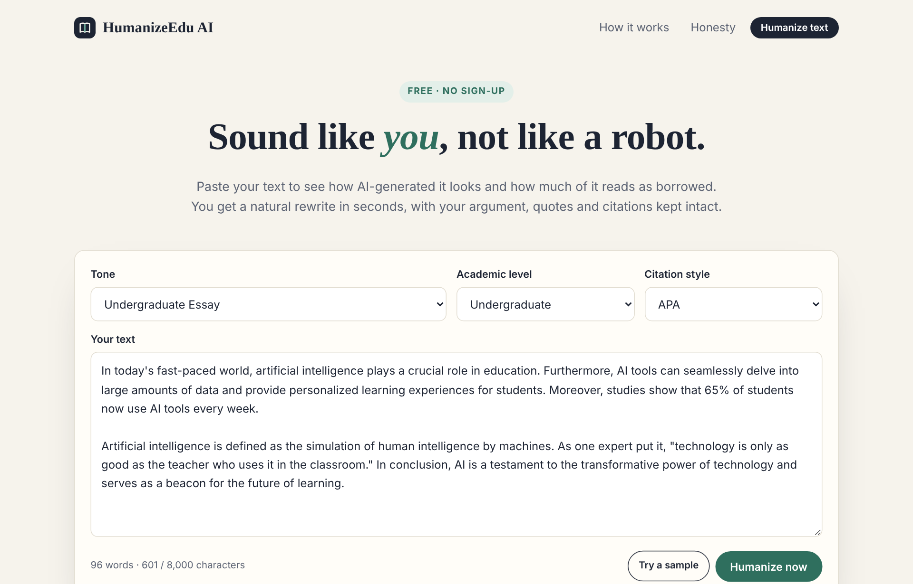
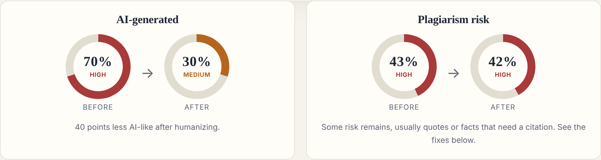
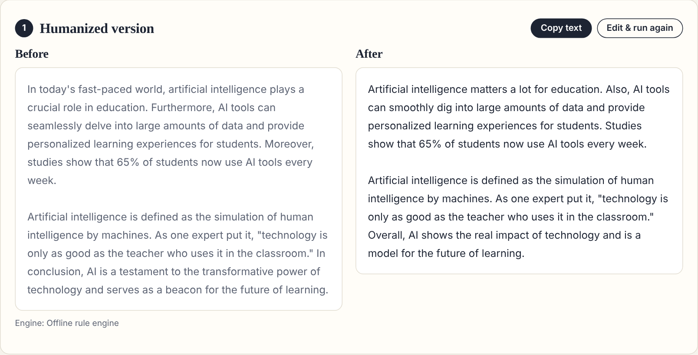

<div align="center">

# ✍️ HumanizeEdu AI

**A free, no-login AI text humanizer built for students. It's honest about what it can and can't do.**

Paste your text. See how **AI-generated** it looks and how much of it carries **plagiarism risk**. Get a natural rewrite in seconds, with your quotes and citations kept exactly as they were.

### 🌐 [Live demo → humanizeedu.onrender.com](https://humanizeedu.onrender.com/)


</div>

> The demo runs on Render's free plan. If nobody has visited for 15 minutes, the first load takes about a minute while the server wakes up.

---

## 📸 Screenshots

| Paste your text | Before → after scores |
|---|---|
|  |  |



---

## ✨ Features

**🔍 Integrity scanner**
- **AI-generated %**: an estimate based on overused AI vocabulary ("delve", "tapestry", "crucial"…), low sentence variety, and stock transitions ("Furthermore", "Moreover"…)
- **Plagiarism-risk %**: flags uncited quotes, definitions and statistics without a source, and generic stock phrasing
- **Copyright & citation fixes**: shows exactly where an APA, MLA, Chicago or IEEE citation is needed

**🪄 Humanization engine**
- Rewrites text with **Groq** (`llama-3.3-70b-versatile`) in the tone you pick: *High School Academic*, *Undergraduate Essay*, *Reflective Journal* or *Casual Study Group*
- Varies sentence rhythm and strips AI buzzwords and filler
- **Locks direct quotes and citations in place.** It never changes facts, numbers or the argument.
- Falls back to Google Gemini, then to a built-in offline rule engine, so it always returns a result

**📚 Free writing guides**
- [Avoiding false AI-detection flags](https://humanizeedu.onrender.com/guides/avoid-false-ai-detection), [APA 7 citation quick guide](https://humanizeedu.onrender.com/guides/apa-citation-guide), [Paraphrasing without plagiarism](https://humanizeedu.onrender.com/guides/paraphrase-without-plagiarism)

**📊 Student toolkit**
- Before/after table: AI %, plagiarism risk, reading grade, reading ease, sentence variety, tone, buzzword count
- One-click copy, "Edit & run again", and a sample text to try it instantly

**🔒 Private and safe by design**
- No login, no database, and **nothing users paste is stored**
- Each visitor is limited to 30 checks per hour, which protects the API key
- Strict security headers (CSP, no framing) and same-origin checks on the API

---

## ⚖️ Academic honesty

HumanizeEdu is meant for **polishing writing you wrote yourself**, fixing false-positive AI flags, and making sure every source gets credit. It is not for submitting ghostwritten work.

Both percentages are **the site's own estimates from writing patterns**. They are **not** Turnitin, GPTZero or Copyleaks results, and the plagiarism figure does not compare text against the web or other papers. The site says this clearly next to the results. Always follow your institution's policy on AI tools.

---

## 🛠️ Tech stack

| Layer | Technology |
|---|---|
| Frontend | HTML, CSS, vanilla JavaScript (responsive, no framework) |
| Backend | Node.js 22, built-in `http` module, **zero npm dependencies** |
| AI | Groq API (Llama 3.3 70B), with optional Google Gemini as backup |
| Analysis | Custom engine: readability, sentence variety (burstiness), tone, buzzwords, citation detection |
| Hosting | Render (free plan); `render.yaml` blueprint included |
| SEO | Auto-generated `sitemap.xml` and `robots.txt`, verified on Google Search Console |

---

## 📁 Project structure

```
humanizeedu/
├── server.js            # Web server: pages, /api/humanize, /api/config, rate limit, security headers
├── lib/
│   ├── analyzer.js      # AI %, plagiarism-risk %, diagnostics, offline humanizer
│   └── ai.js            # Groq → Gemini → offline rewriting
├── public/
│   ├── index.html       # Homepage with the tool
│   ├── guides/          # SEO writing guides
│   ├── privacy.html
│   ├── css/style.css
│   └── js/app.js        # Frontend logic and score gauges
├── test/smoke.js        # End-to-end tests
├── docs/                # README screenshots
├── render.yaml          # One-click Render deploy
├── deploy/setup-vm.sh   # Optional Google Cloud VM deploy
└── Dockerfile           # Optional Google Cloud Run deploy
```

---

## 🚀 Run it locally

**Requirements:** [Node.js 22.9+](https://nodejs.org) and a free [Groq API key](https://console.groq.com/keys).

```bash
git clone https://github.com/QURSAM-70179225/humanizeedu.git
cd humanizeedu
cp .env.example .env        # Windows: copy .env.example .env
# open .env and paste your key after GROQ_API_KEY=
npm start                   # → http://localhost:8080
npm test                    # run the end-to-end tests
```

No `npm install` is needed, because the project has no dependencies.

### Environment variables

| Variable | Required | Description |
|---|---|---|
| `GROQ_API_KEY` | Recommended | Turns on AI rewriting. Without it, the offline engine is used |
| `GROQ_MODEL` | No | Default `llama-3.3-70b-versatile` |
| `GEMINI_API_KEY` | No | Backup AI provider |
| `RATE_LIMIT_PER_HOUR` | No | Checks per visitor per hour (default 30) |
| `DONATE_URL` | No | Your Buy Me a Coffee / Ko-fi link. The ☕ Support buttons appear only when this is set |
| `NODE_ENV` | No | `production` on the live server |

> Never commit your `.env` file. It's already listed in `.gitignore`.

---

## ☁️ Deploy your own copy (free)

1. Fork this repo.
2. On [Render](https://render.com), go to **New → Blueprint** and select your fork.
3. Paste your `GROQ_API_KEY` when asked, then click **Apply**.

Every `git push` redeploys automatically.

---

## 🔌 API

`POST /api/humanize`

```json
{ "text": "Your paragraph…", "tone": "Undergraduate Essay", "level": "Undergraduate", "citation": "APA" }
```

The response includes `humanized`, `engine`, `changes`, and `before` / `after` reports, each with `ai.score` and `plagiarism.score`.

---

## 👩‍💻 Author

**Qursam Bibi**, AI Developer & Full-Stack Engineer  
B.S. Information Engineering Technology, The University of Lahore

⭐ If you find this project useful, consider giving it a star!
